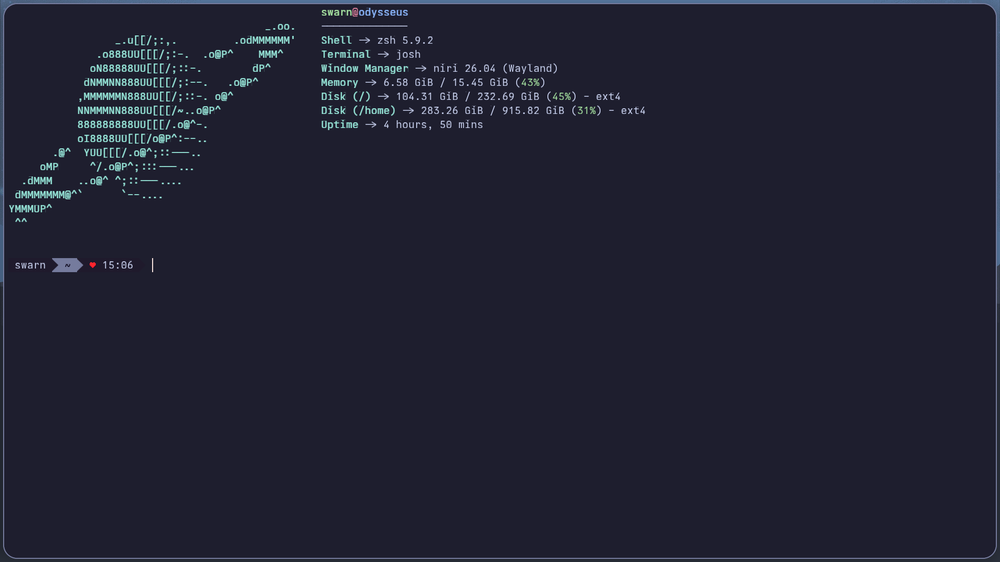

# josh

Josh is a libghostty-vt powered terminal written in jai.



## Build

```sh
jai-linux first.jai
```

## Configuration

Configuration is read from `$XDG_CONFIG_HOME/josh/config.dix` (or
`$HOME/.config/josh/config.dix` when `XDG_CONFIG_HOME` is unset) and uses the
[dix](https://github.com/demonkingswarn/dix) language. Everything is optional.

## Features

- Real PTY (`fork`/`setsid`/`TIOCSCTTY`), so full-screen apps, job control and signals work.
- Full VT parsing via libghostty-vt.
- Truecolor, 256-color and 16-color output.
- Text styles: bold, faint, underline, strikethrough, inverse, colored underline.
- Cursor styles (block, bar, underline, hollow block), blinking and custom color.
- Box drawing, block elements, braille, arrows and math symbols.
- Nerd Font glyphs (Powerline separators, dev icons, Font Awesome).
- Ligatures, CJK, and color emoji (ZWJ sequences) via HarfBuzz + FreeType/librsvg, with Fontconfig fallback.
- Kitty graphics protocol: inline images, animations and z-ordering.
- Text selection (click, drag, double/triple-click, Alt-drag block) with copy.
- Mouse reporting to apps (X10, SGR, UTF-8, URxVT).
- Scrollback (mouse wheel), typing returns to the bottom.
- Window title from the terminal's OSC sequence.
- Configuration via dix (font, font size, padding, colors).

